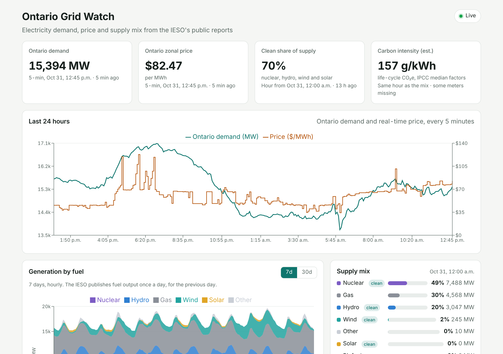
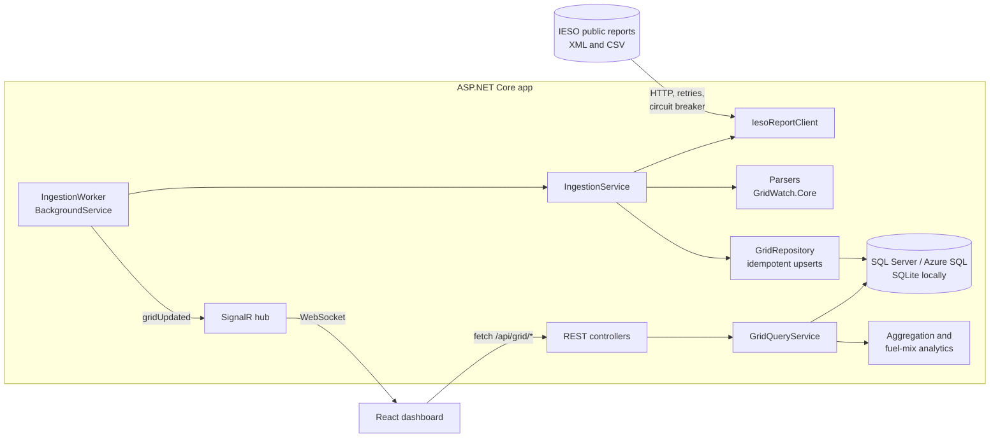

# Ontario Grid Watch

[](https://github.com/RamjeU/ontario-grid-watch/actions/workflows/ci.yml)


A live dashboard for Ontario's electricity system. An **ASP.NET Core** service pulls the IESO's public market reports on a schedule, stores them with **Entity Framework Core** in **SQL Server / Azure SQL**, and serves a REST API and **SignalR** push updates to a **React** front end. It shows demand, real-time price, generation by fuel and an estimate of carbon intensity.



## What it shows

- **Ontario demand and price every 5 minutes**, from the IESO Realtime Totals and Ontario Zonal Price reports, with a 24-hour chart.
- **Generation by fuel** (nuclear, hydro, gas, wind, solar, biofuel, other), hourly for 7 days or as daily averages for 30 days.
- **Supply mix and clean share**, the share of output from non-emitting sources.
- **Estimated carbon intensity** in g CO₂e/kWh, using IPCC median life-cycle emission factors.
- **Daily summary**: peak and average demand, average price, clean share and intensity per market day. Days with unpublished hours are marked partial.
- **Live updates**: the server pushes a SignalR message when new data lands, and the page refreshes the affected charts.

## Architecture



The solution is split into three projects so each layer can be tested on its own:

| Project | Responsibility | Depends on |
| --- | --- | --- |
| `GridWatch.Core` | Domain types, IESO report parsers, analytics (fuel mix, aggregation, time ranges). No I/O. | Nothing |
| `GridWatch.Infrastructure` | EF Core `DbContext` and migrations, repository, IESO HTTP client, ingestion service and background worker. | Core |
| `GridWatch.Api` | ASP.NET Core host: controllers, SignalR hub, security middleware, OpenAPI, static React files. | Infrastructure |

## Data sources

All data comes from the [IESO public reports site](https://reports-public.ieso.ca/public/). No API key is needed.

| Report | File | Published | Used for |
| --- | --- | --- | --- |
| Realtime Totals | `RealtimeTotals/PUB_RealtimeTotals_YYYYMMDDHH.xml` | Each hour, filled every 5 min | Ontario demand, 5-minute |
| Real-Time Ontario Zonal Price | `RealtimeOntarioZonalPrice/PUB_RealtimeOntarioZonalPrice_YYYYMMDDHH.xml` | Each hour, filled every 5 min | Price, 5-minute |
| Hourly Demand | `Demand/PUB_Demand_YYYY.csv` | A few times a day | Ontario and market demand, hourly |
| Generator Output by Fuel Type | `GenOutputbyFuelHourly/PUB_GenOutputbyFuelHourly_YYYY.xml` | Daily, for the previous day | Hourly output per fuel |

The app ships with two weeks of real IESO data (17 to 30 October 2026), which loads into an empty database. The dashboard therefore works offline, in tests and on first start.

## Design decisions

- **Market time is EST all year.** The IESO labels hours "hour ending 1 to 24" in Eastern Standard Time with no daylight saving shift. `MarketTime` converts to UTC at the edge, and everything inside the system is UTC. The UI shows Toronto local time.
- **Ingestion is idempotent.** Tables use natural keys (hour, or hour plus fuel), and the repository updates only rows whose values changed. Re-reading a report is safe, and IESO revisions are picked up.
- **Each source is polled at its own pace.** Real-time files are checked every 5 minutes, hourly demand every 15 minutes, and the daily fuel report hourly. Hours that already have all twelve 5-minute values are skipped.
- **Failures are recorded rather than hidden.** Every ingestion attempt is stored as an `IngestionRun` with row counts and any error, and is visible at `GET /api/ingestion/runs`.
- **Parsers tolerate bad rows.** A malformed row is skipped and reported as a warning instead of failing the whole file. Missing output is stored as null rather than zero, and the IESO's quality flag is kept as a count of missing metering points.
- **Charts follow the data, not the clock.** The sources publish on different lags, so each chart ends at the latest data available for it, and each headline number shows its own "as of" time.
- **Carbon intensity is labelled an estimate.** It is the output-weighted average of IPCC AR5 WGIII Annex III (2014) median life-cycle factors: nuclear 12, wind 11, hydro 24, solar 48, biomass 230 and gas (combined cycle) 490 g/kWh. Ontario's gas peakers emit more than the combined-cycle figure, so the estimate leans low. "Other" has no single factor and is left out.

## Security

- **XML parsing** prohibits DTDs and external entities, which blocks XXE attacks. A test checks this.
- **Admin endpoint:** `POST /api/ingestion/run` requires an `X-Api-Key` header, compared as SHA-256 hashes in constant time. It is disabled when no key is configured.
- **Rate limiting** applies per client IP: 120 requests a minute for reads and 5 a minute for the admin endpoint.
- **Security headers:** Content Security Policy (`default-src 'self'`), `X-Frame-Options: DENY`, `nosniff`, a referrer policy and HSTS outside development.
- **Input validation:** time ranges are checked and bounded (7 days for 5-minute data, 92 days otherwise). Errors use RFC 9457 problem details.
- **Secrets:** none are in the repo. Use user secrets locally and App Service settings in Azure. CI scans dependencies for known vulnerabilities, and a vulnerable transitive package is pinned to a patched version.
- **Container:** the image runs as a non-root user.

## Getting started

### Prerequisites

- [.NET 10 SDK](https://dotnet.microsoft.com/download)
- [Node.js 22](https://nodejs.org/)
- Docker (optional, for SQL Server)

### Run it locally

```bash
git clone https://github.com/RamjeU/ontario-grid-watch.git
cd ontario-grid-watch

# API on http://localhost:5080 (SQLite file, loads sample data, then starts polling the IESO)
dotnet run --project src/GridWatch.Api

# In a second terminal: the React dev server on http://localhost:5173
cd web
npm install
npm run dev
```

Open http://localhost:5173. The interactive API reference is at http://localhost:5080/docs.

To serve everything from the API on one port, build the UI first. It is written into `src/GridWatch.Api/wwwroot`:

```bash
cd web && npm run build && cd ..
dotnet run --project src/GridWatch.Api   # open http://localhost:5080
```

### Run with SQL Server (Docker)

```bash
cp .env.example .env        # set your own SQL password
docker compose up --build   # open http://localhost:8080
```

### Enable the admin endpoint

```bash
dotnet user-secrets set "Admin:ApiKey" "$(openssl rand -base64 32)" --project src/GridWatch.Api
curl -X POST "http://localhost:5080/api/ingestion/run?target=All" -H "X-Api-Key: <your key>"
```

## API

| Method | Path | Description |
| --- | --- | --- |
| GET | `/api/grid/snapshot` | Latest 5-minute demand and price, latest hourly demand and the latest hour's fuel mix |
| GET | `/api/grid/realtime?from&to` | 5-minute demand and price (default: last 24 h; at most 7 days) |
| GET | `/api/grid/generation?from&to&resolution=Hour\|Day` | Output by fuel (default: last 7 days) |
| GET | `/api/grid/demand?from&to` | Hourly Ontario and market demand |
| GET | `/api/grid/prices?from&to` | Hourly average, minimum and maximum price |
| GET | `/api/grid/daily?from&to` | One summary row per market day (default: 14 days) |
| GET | `/api/ingestion/runs?count` | Recent ingestion attempts, including errors |
| POST | `/api/ingestion/run?target=All\|Realtime\|Demand\|FuelOutput` | Run ingestion now (requires `X-Api-Key`) |
| GET | `/health` | Health check, including the database |
| WS | `/hubs/grid` | SignalR hub; sends `gridUpdated` after new data lands |

`from` and `to` accept ISO 8601 timestamps. All returned times are UTC.

## Configuration

Settings live in `appsettings.json` and can be overridden with environment variables, using `__` for nesting (for example `Ingestion__PollMinutes=10`).

| Setting | Default | Meaning |
| --- | --- | --- |
| `Database:Provider` | `Sqlite` | `Sqlite` or `SqlServer` |
| `ConnectionStrings:GridWatch` | `Data Source=gridwatch.db` | Database connection string |
| `Ingestion:Enabled` | `true` | Run the background worker |
| `Ingestion:SeedSampleData` | `true` | Load the bundled sample into an empty database |
| `Ingestion:PollMinutes` | `5` | Worker tick interval |
| `Ingestion:BackfillDays` | `45` | Days of hourly data kept on each load |
| `Ingestion:RealtimeBackfillHours` | `48` | Hours of 5-minute data fetched at startup |
| `Admin:ApiKey` | empty | Enables the admin endpoint when set |
| `Cors:AllowedOrigins` | none (`localhost:5173` in development) | Origins allowed to call the API from a browser |

## Tests

```bash
dotnet test                       # 57 tests: unit, ingestion and API integration
cd web && npm test                # 9 tests: formatting and components
```

- **Unit tests** cover market-time conversion (including daylight saving), all four parsers (against the real IESO sample files and edge cases such as XXE input), fuel-mix and carbon-intensity calculations, aggregation and range validation.
- **Ingestion tests** run against a fake IESO server on in-memory SQLite. They cover idempotency, revisions, the backfill window, skipping unpublished and complete hours, and failures recorded as failed runs.
- **API integration tests** host the real app with `WebApplicationFactory`. They check every endpoint, problem-details errors, security headers, API-key rejection, the SignalR broadcast and static UI serving.
- **SQL Server test** applies the EF Core migration to a real SQL Server and runs seeding, upserts and queries on it. CI provides a SQL Server container; locally, set `GRIDWATCH_SQLSERVER` to a connection string to run it.

CI runs on every push: formatting, a warnings-as-errors build, all tests (including SQL Server), a dependency vulnerability scan, front-end lint, typecheck, tests and build, and a Docker build with a smoke test.

## Deploying to Azure

[`infra/main.bicep`](infra/main.bicep) creates a Linux App Service and an Azure SQL Database on the free offer, in Canada Central. See [docs/deploy-azure.md](docs/deploy-azure.md) for the step-by-step guide.

## Project structure

```
src/
  GridWatch.Core/            Domain, parsers, analytics (no I/O)
  GridWatch.Infrastructure/  EF Core, migrations, IESO client, ingestion, sample data
  GridWatch.Api/             Controllers, SignalR hub, security, Program.cs
tests/GridWatch.Tests/       xUnit: Core, Infrastructure, Api
web/                         React + TypeScript + Vite dashboard
infra/                       Bicep template for Azure
docs/                        Azure deployment guide, code walkthrough, screenshot
```

## Limitations and next steps

- Emissions are estimated from global median factors, not measured Ontario plant emissions.
- On the free App Service tier, ingestion pauses while the site is idle and catches up on the next visit.
- Upserts load the incoming time window and compare in memory. This suits these volumes, but a larger system would use a bulk `MERGE`.
- Possible additions: per-generator output from the GenOutputCapability report, intertie flows, and passwordless Azure SQL access with managed identity.

## License and data

The code is MIT licensed. Electricity data is published by the Independent Electricity System Operator (IESO). This project is not affiliated with or endorsed by the IESO.
